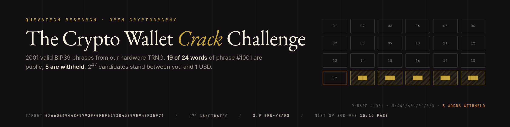
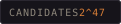
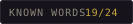
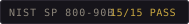
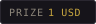

<p align="center">
  
</p>

<p align="center">
  
  
  
  
</p>

# QuevaTech BIP39 Challenge — 2001 phrases, 19/24 words public

This repository contains **2001 valid 24-word BIP39 mnemonics** generated from our hardware
entropy source (pass.queva.tech TRNG pool, NIST SP 800-90B **15/15 PASS**).

2000 of them are published in full. **The last 5 words of phrase #1001 are withheld.** The
EVM address derived from that phrase holds **1 USD**. Recover the five words, sweep the
address, keep it.

> This is not a marketing raffle — it is a measurable claim: *an open experiment showing why
> 256-bit entropy is 256-bit entropy.* The table below is not a wish; you can reproduce it on
> your own hardware with `tools/measure_hashrate.py`.

## Why this challenge cannot be won

24 words = **256 bits of entropy + 8 bits of checksum**. Only 3 of the last word's 11 bits are
entropy; the other 8 are checksum. With the last *k* words hidden, the number of *valid* phrases
is **2^(11k−8)**:

| Hidden words | Candidates | CPU (measured: 605/s) | 1× RTX 4090 (~5×10^5/s) | 8× GPU rig (~4×10^6/s) |
|---|---|---|---|---|
| 2 | 2^14 = 16,384 | 27 s | instant | instant |
| 3 | 2^25 = 33,554,432 | 15.4 h | ~1 min | ~8 s |
| 4 | 2^36 = 68,719,476,736 | 3.6 years | ~1.6 days | ~5 h |
| **5** | **2^47 = 140,737,488,355,328** | **7,386 years** | **~8.9 years** | **~1.1 years** |

At `k=5` a single attacker needs **8.9 GPU-years** just to enumerate and derive addresses.
Power plus hardware costs exceed the prize by ~10^8. Breaking this requires breaking 256-bit
key space first.

**The checksum shortcut does not save you.** Pre-filtering with the cheap SHA-256 checksum helps
at `k=3` (raw space 2^33, seconds on a GPU), but at `k≥4` the raw space stays 1.76×10^13 —
hours of filtering alone, and 2^36 PBKDF2 derivations behind it.

## Honest limits (stated before anyone else states them)

1. **The 2000 decoy phrases carry zero information about phrase #1001.** They were generated
   from independent TRNG blocks; the list adds theatre, not difficulty. "Haystack" is
   marketing, not cryptography. The real cost is the table above.
2. **Entropy provenance is attested, not provable.** The pool sha256, slice offset and read
   timestamp are in `data/manifest.json`, but nobody can independently verify that these bytes
   came from a TRNG. What *is* verifiable: phrase validity, checksums, addresses, arithmetic.
3. **The prize will most likely never be claimed.** That is deliberate: the point is not that
   someone wins, it is showing how the cost explodes as `k` grows. A prize still sitting there
   in five years is a result, not a failure.
4. **Never use the published phrases as a wallet.** They are public; anything sent to their
   addresses is taken instantly. Read `WARNING.md`.

## Contents

```
data/phrases_0001-1000.txt     #1000 full phrases, one 24-word mnemonic per line
data/phrases_1002-2001.txt     #1000 full phrases
data/phrase_1001_redacted.txt  19 words + 5 × ███████
data/manifest.json             per-phrase sha256 + derived EVM address + TRNG metadata
data/MANIFEST.sha256           file integrity
tools/verify_phrases.py        independent verifier (checksum + addresses + manifest)
tools/solve.py                 reference solver + hashcat/btcrecover command generator
tools/measure_hashrate.py      measure candidates/s on your hardware, rebuild the table
submissions/README.md          how to report a solution
```

Standard English BIP39 wordlist (2048 words; `wordlist.sha256` is in the manifest).
Addresses are `m/44'/60'/0'/0/0` EVM addresses.

## Verify (30 seconds)

```bash
pip install mnemonic
python tools/verify_phrases.py             # checksum + manifest
python tools/verify_phrases.py --addresses # re-derive all 2001 addresses (~30 s)
```

Expected: `ALL CHECKS PASSED`.

## Attack it

```bash
pip install mnemonic
python tools/solve.py --tools         # prints btcrecover / hashcat invocations
python tools/solve.py --limit 100000  # reference solver (slow: ~13k candidates/s)
python tools/solve.py --self-test     # proves the solver is correct
```

**Critical:** a checksum does not identify the phrase. With `k` hidden words there are
**2^(11k−8) different valid phrases** sharing the same known prefix; only the derived address
disambiguates them. `solve.py` therefore matches against the address in `data/manifest.json`.
A solver that stops at the first checksum-valid candidate will "find" the wrong phrase.

For real work use GPU tooling: `hashcat -m 26600` (MetaMask/BIP39) or
[btcrecover](https://github.com/3rdIteration/btcrecover) `--bip39 --mnemonic-prefix ...`.
Feed your measured rate back in with `tools/measure_hashrate.py --gpu-rate <N>`.

## Prize

| | |
|---|---|
| Amount | **1 USD** (on an EVM network such as Base/Polygon/Arbitrum; on ETH mainnet gas would eat it) |
| Address | `0x660e69448f97939f0Fef6173b45B99e94eF35f76` |
| Derivation | `m/44'/60'/0'/0/0`, phrase #1001 |
| Win condition | First transaction that sweeps the address. No submission required. |

The address also appears in `data/manifest.json` → `entries["1001"]`. The phrase itself is not
in this repository and never will be.

## Hall of Fame

Empty. At `k=5` the expected time is 8.9 GPU-years — an empty list is the expected outcome.
If you build a solution, open a PR in the `submissions/README.md` format with method, measured
rate and elapsed time. Verified solutions are listed here.

## License

Code MIT (`LICENSE`), data and docs CC BY 4.0. Use the phrases in your own research; attribution
is enough.

## Contact

QuevaTech — https://queva.tech · Security: security@queva.tech
