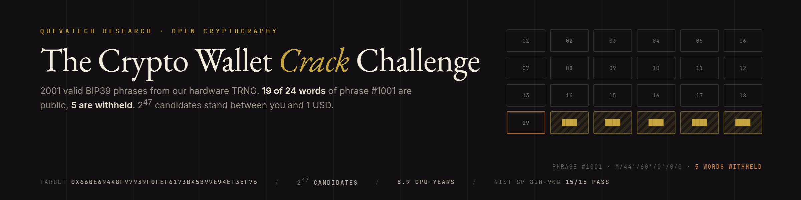
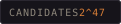
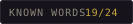
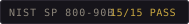
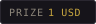

<p align="center">
  
</p>

<p align="center">
  
  
  
  
</p>

# QuevaTech BIP39 Yarışması — 2001 cümle, 19/24 kelime açık

Bu depo donanım entropimizden (pass.queva.tech TRNG havuzu, NIST SP 800-90B **15/15 PASS**)
üretilmiş **2001 adet geçerli 24 kelimelik BIP39 cümlesi** içerir.

2000 tanesi tam olarak yayınlandı. **1001. cümlenin son 5 kelimesi saklı.** O cümlenin
türettiği EVM adresinde **1 USD** duruyor. Son 5 kelimeyi bulup adresi süpüren kazanır.

> Bu bir reklam yarışması değil, ölçülebilir bir iddia: *256 bit entropinin neden 256 bit
> olduğunu gösteren açık deney.* Aşağıdaki tablo bir temenni değil, kendi donanımında
> `tools/measure_hashrate.py` ile yeniden üretebileceğin bir hesap.

---

## Neden bu yarışma teknik olarak kazanılamaz

24 kelime = **256 bit entropi + 8 bit checksum**. Son kelimenin 11 bitinin yalnızca 3'ü
entropi, 8'i checksum'dır. Son *k* kelime gizliyse geçerli cümle sayısı **2^(11k−8)**:

| Gizli kelime | Aday sayısı | CPU (ölçüm: 605 aday/s) | 1× RTX 4090 (~5×10^5/s) | 8× GPU rig (~4×10^6/s) |
|---|---|---|---|---|
| 2 | 2^14 = 16.384 | 27 s | anlık | anlık |
| 3 | 2^25 = 33.554.432 | 15,4 saat | ~1 dakika | ~8 saniye |
| 4 | 2^36 = 68.719.476.736 | 3,6 yıl | ~1,6 gün | ~5 saat |
| **5** | **2^47 = 140.737.488.355.328** | **7.386 yıl** | **~8,9 yıl** | **~1,1 yıl** |

`k=5` için bir saldırganın **yalnızca aday üretip adres türetmesi** 8,9 GPU-yılı sürer.
Elektrik + donanım maliyeti ödülün ~10^8 katı. Kırılabilir olması için önce 256 bitin
çökmesi gerekir.

**Checksum hilesi kurtarmaz:** checksum'ı ucuz SHA-256 ile ön elemek `k=3`'te işe yarar
(ham uzay 2^33, GPU'da saniyeler), `k≥4`'te ham uzay hâlâ 1,76×10^13 → eleme tek başına
saatler sürer, geriye 2^36 PBKDF2 kalır.

## Neyin doğru, neyin yanlış olduğunu baştan söyleyelim

Bu deponun dürüst sınırları (eleştirilmeden önce kendimiz yazıyoruz):

1. **2000 yan cümle, 1001. cümle hakkında sıfır bilgi taşır.** Cümleler bağımsız TRNG
   bloklarından üretildi; liste kalabalık yapar, zorluk **eklemez**. "Samanlık" anlatısı
   pazarlama tarafıdır, kriptografik tarafı değil. Kırma maliyeti yukarıdaki tablodur.
2. **Entropi kaynağı kanıtlanamaz, beyan edilir.** Havuzun sha256'sı, dilimi, ofseti ve
   okuma zamanı `data/manifest.json` içinde; ama kimse bu baytların gerçekten TRNG'den
   geldiğini bağımsız doğrulayamaz. Doğrulanabilir olan: cümlelerin geçerliliği, checksum,
   adresler ve matematik.
3. **Ödül büyük olasılıkla hiç alınmaz.** Bu bilinçli: yarışmanın amacı “birinin kazanması”
   değil, `k` arttıkça maliyetin nasıl patladığını göstermek. Ödül 5 yıl sonra da orada
   duruyorsa bu bir başarısızlık değil, sonuçtur.
4. **Yayınlanan 2000 cümleyi cüzdan olarak kullanma.** Bu cümleler herkese açık; onlara
   gönderilen her şey anında alınır. `WARNING.md` dosyasını oku.

---

## Depo içeriği

```
data/phrases_0001-1000.txt      #1000 tam cümle (24 kelime, satır başına bir cümle)
data/phrases_1002-2001.txt      #1000 tam cümle
data/phrase_1001_redacted.txt   19 kelime + 5 × ███████
data/manifest.json              cümle başına sha256 + türetilmiş EVM adresi + TRNG künyesi
data/MANIFEST.sha256            dosya bütünlüğü
tools/verify_phrases.py         bağımsız doğrulayıcı (checksum + adres + manifest)
tools/solve.py                  referans çözücü + hashcat/btcrecover komut üretici
tools/measure_hashrate.py       kendi donanımında aday/s ölç, tabloyu yeniden üret
submissions/README.md           çözüm bildirimi
```

Hepsi İngilizce BIP39 listesi (2048 kelime, `wordlist.sha256` manifest içinde):
`m/44'/60'/0'/0/0` EVM adresleri manifest'te hazır.

## Doğrulama (30 saniye)

```bash
pip install mnemonic
python tools/verify_phrases.py            # checksum + manifest
python tools/verify_phrases.py --addresses # 2001 adresi yeniden türetir (~30 s)
```

Beklenen çıktı: `ALL CHECKS PASSED`.

## Kırma denemesi

```bash
pip install mnemonic
python tools/solve.py --tools        # btcrecover / hashcat komutlarını yazar
python tools/solve.py --limit 100000 # referans çözücü (yavaş: ~13k aday/s)
python tools/solve.py --self-test    # çözücünün doğruluğunu kanıtlar
```

**Kritik uyarı:** checksum tek başına cümleyi tanımlamaz. `k` gizli kelime için aynı öneki
paylaşan **2^(11k−8) farklı geçerli cümle** vardır. Doğru cümleyi yalnızca türetilen adres
ayırt eder. `solve.py` bu yüzden `data/manifest.json` içindeki adrese eşleşme arar.
Bunu bilmeyen bir çözücü, checksum'ı tutan ilk cümleyi "buldum" sanır.

Gerçek iş için GPU araçları: `hashcat -m 26600` (MetaMask/BIP39) veya
[btcrecover](https://github.com/3rdIteration/btcrecover) `--bip39 --mnemonic-prefix ...`.
Ölçtüğün hızı `tools/measure_hashrate.py --gpu-rate <N>` ile tabloya koyabilirsin.

## Ödül

| | |
|---|---|
| Tutar | **1 USD** (Base/Polygon/Arbitrum gibi bir EVM ağında; ETH mainnet'te gas'a gider) |
| Adres | `0x660e69448f97939f0Fef6173b45B99e94eF35f76` |
| Türetme | `m/44'/60'/0'/0/0`, cümle #1001 |
| Kazanma koşulu | Adresi süpüren ilk işlem. Ek gönderim/başvuru yok. |

Adres `data/manifest.json` → `entries["1001"]` içinde de var; cümlenin kendisi bu depoda
yok ve olmayacak.

## Hall of Fame

Henüz kimse yok. `k=5` için beklenen süre 8,9 GPU-yılı — bu satırın boş kalması normaldir.
Bir çözüm üretirsen `submissions/README.md` formatında PR aç; matematiksel yöntem + ölçülen
hız + süre yaz. Doğrulanan çözümler buraya işlenir.

## Lisans

Kod MIT (`LICENSE`), veri ve doküman CC BY 4.0. Cümleleri kendi araştırmanda kullanabilirsin;
kaynağı belirtmen yeterli.

## İletişim

QuevaTech — https://queva.tech · Güvenlik: security@queva.tech
